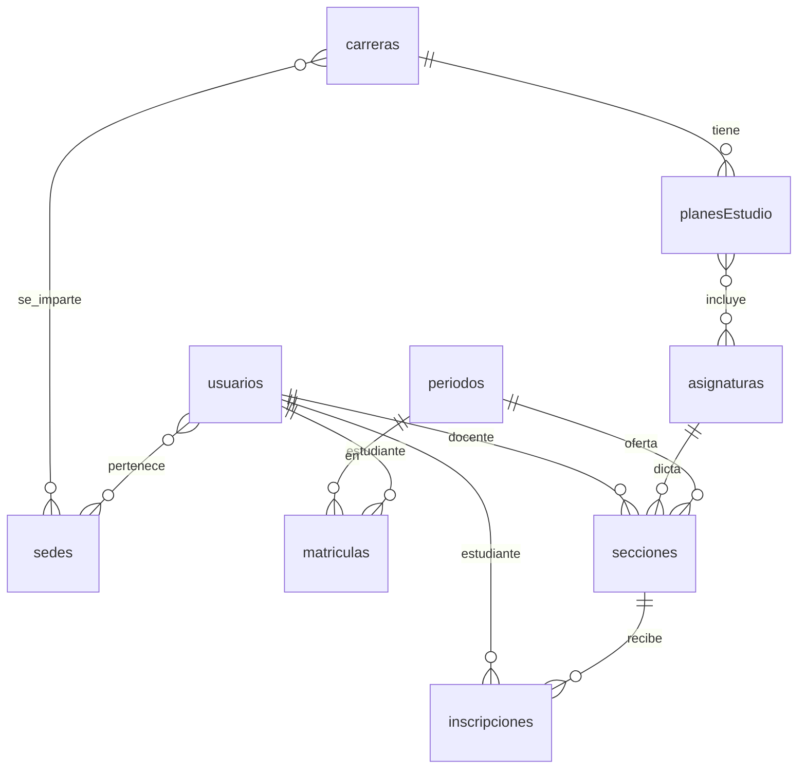

---
name: Pendientes SGA y roles
overview: "Diagnostico: el frontend es un prototipo completo con datos mock y no existe backend ni carpeta db. Este plan lista las tareas pendientes de backend y frontend y define reglas por rol y el modelo MongoDB, con cuenta unica + perfil academico enlazado y permisos fijos en codigo."
todos:
  - id: e0
    content: "Bootstrap backend/ y db/: Express, Mongoose, cors, morgan, .env, manejador de errores, modelos y seed"
    status: pending
  - id: e1
    content: Auth JWT + bcrypt, middlewares authenticate/authorize fijos por rol, ABM usuarios y parametros
    status: pending
  - id: e2-e6
    content: APIs de estructura, periodos, personas, matriculas, secciones (con bloques embebidos) con validaciones
    status: pending
  - id: e8
    content: Inscripcion con 7 reglas, cupo atomico y anulacion; consulta de oferta
    status: pending
  - id: e9-e11
    content: Portal docente, reportes, tests de reglas y documentacion de API
    status: pending
  - id: fe-api
    content: Cliente HTTP, AuthContext real y reemplazo de mocks/contexts por la API
    status: pending
  - id: fe-ux
    content: Fusionar ABM usuarios/personas, permisos solo lectura, errores de regla del backend, limpieza de repo
    status: pending
isProject: false
---

# Pendientes SGA, reglas por rol y modelo MongoDB

## Estado actual
- **Frontend** (`frontend/`): React + Mantine + TS con pantallas para los 4 perfiles, todo sobre mocks en memoria (`src/mock/*`, `src/mocks/*`, `AuthContext.tsx` con login simulado, `PermisosContext.tsx` en memoria, `features/usuarios/users.ts` y `features/*/rules.ts` con reglas en el cliente). No hay llamadas HTTP (ni axios ni cliente API).
- **Backend / db**: no existen `backend/` ni `db/`. Todo esta por construir.
- `backlog-sga.md` (85 tarjetas) esta referenciado pero **no esta en el repo**; usamos `context/specs/backlog.md` como mapa.

## Decisiones tomadas
- **MVP simplificado**: una sola coleccion `usuarios` con `perfilDocente` / `perfilEstudiante` embebidos segun el rol (no existen `docentes` ni `estudiantes`). Admin crea la cuenta; el coordinador edita el perfil academico (docente/estudiante).
- Sin coleccion `salas` ni `salaId` en bloques: la sala es un texto opcional en la seccion; el choque de sala se difiere/simplifica.
- Bloques horarios embebidos en `secciones`; historial de aprobadas embebido en el perfil del estudiante.
- Permisos **fijos por rol en codigo** (middleware); la pantalla "Permisos" del admin queda informativa (no hay coleccion `permisos`).

## Tareas pendientes - Backend (Node + Express + Mongoose + morgan + cors)

Orden segun ruta critica (E0 -> E1/E3 -> E2/E4 -> E5/E6 -> E7/E8 -> E9/E10/E11):

1. **E0 Base**: crear `backend/` (`src/{config,models,routes,controllers,services,middlewares,utils}`), `.env` (`MONGO_URI`, `JWT_SECRET`, `PORT`, `CORS_ORIGIN`; nunca en git), conexion Mongoose, `cors` con origen del front, `morgan('dev')`, manejador global de errores con formato `{ code, regla, message }`, healthcheck. Carpeta `db/` con seed (3 sedes, 4 carreras, 2 planes, 40 asignaturas, 20 docentes, 200 alumnos, 2 periodos, historial de aprobadas).
2. **E1 Auth y usuarios**: `POST /auth/login` (bcrypt + JWT), `GET /auth/me`, cambio/recuperacion de clave, middleware `authenticate` + `authorize(...roles)`, ABM usuarios con baja logica (solo admin), `duracionSesionMinutos` desde parametros.
3. **Parametros institucionales**: `GET/PUT /parametros` (admin escribe; todos leen lo publico).
4. **E2 Estructura**: sedes, carreras (cierre a nuevo ingreso si hay matriculados), planes, asignaturas y prerrequisitos por plan con **deteccion de ciclos**.
5. **E3 Periodos**: maquina de estados `planificacion -> inscripcion abierta -> en curso -> cerrado`, un solo periodo en curso, ventana de inscripcion distinta del semestre.
6. **E4 Docentes y estudiantes**: se gestionan sobre `usuarios` (filtro por rol, perfil embebido), RUT/correo/codigoEstudiante unicos, baja logica.
7. **E5 Matricula**: una sola vigente por estudiante y periodo; estados `vigente|suspendida|egresada|retirada`.
8. **E6 Oferta y horarios**: ABM `secciones` con `bloques[]` embebidos (sin `salaId`); choque de docente obligatorio. Choque de sala: opcional, por texto `seccion.sala` en modalidad presencial (puede quedar fuera del MVP).
9. **E7 Consulta de oferta**: filtros asignatura, jornada, modalidad, dia, cupo; default plan del alumno.
10. **E8 Inscripcion (7 reglas, un mensaje de error distinto cada una)**: matricula vigente, ventana, cupo (atomico con `findOneAndUpdate({ $expr: inscritos < cupo }, { $inc })`), plan, prerrequisitos, aprobacion previa, choque de horario; mas anulacion que libera cupo (estado `anulada`).
11. **E9 Portal docente**: mis secciones, nomina, horario (solo lectura, filtrado por el `sub` del token).
12. **E10 Reportes**: matriculas, estudiantes por carrera/asignatura, ocupacion de secciones, cupos, carga docente.
13. **E11 NFR/evidencia**: tests de las 7 reglas contra la API (sin React), documentacion de API, diagrama de CU, guion de demo.

## Tareas pendientes - Frontend
1. Crear cliente HTTP (`src/lib/api.ts`) con base URL por `.env`, interceptor de JWT y manejo de 401/403.
2. Reemplazar `AuthContext` mock por login real (`/auth/login`, `/auth/me`), guardar token, rol y datos del usuario reales; quitar `cambiarRol` en produccion.
3. Reemplazar cada Context/mock por llamadas a la API: `SedesContext`, `EstructuraContext`, `PeriodosContext`, `PersonasContext`, `MatriculaContext`, `OfertaContext`, `ParametrosContext`, `users.ts`, `reportes`, `docente/useSeccionesDocente`, inscripcion/horario del estudiante.
4. Mover/duplicar reglas academicas: dejar `rules.ts` solo como validacion previa; mostrar el mensaje de regla que devuelve el backend (`ReglasRechazadasModal`).
5. Fusionar los dos ABM (Usuarios admin y Personas coordinador) en un solo recurso `/usuarios`: el formulario muestra los campos de perfil segun el rol elegido (docente o estudiante).
6. `MatrizPermisosPage`: pasar a solo lectura (permisos fijos) o eliminarla.
7. Estados de carga/error, paginacion servidor (`PaginacionBar`), recuperacion de clave, pagina de cambio de clave.
8. Pendientes de dominio: catalogo de jornadas, semipresencial (modalidad por bloque o heredada), electivas (bolsa libre o lista fija), tope de creditos (8va regla), historial (solo seed). Decidir en grupo y registrar en `context/decisions/log.md`.
9. Corregir texto con encoding roto en `mocks/parametros.ts` ("FormaciA3n", "acadAcmico").
10. Quitar `.DS_Store` del repo y agregar `backend/.env` a `.gitignore`.

## Reglas por tipo de usuario

### Administrador
- Gestiona **usuarios** (alta, edicion, baja logica; no puede borrar fisicamente), restablece claves, asigna rol y sedes.
- Gestiona **parametros** institucionales.
- Consulta **reportes**. Lectura de estructura (el backlog dice que estructura es del coordinador; el enunciado lo lista en CU2: decision pendiente de usar solo lectura).
- No inscribe, no matricula, no crea oferta.
- No puede desactivarse a si mismo ni dejar el sistema sin admin activo.

### Coordinador Academico
- CRUD de **sedes, carreras, planes, asignaturas, prerrequisitos**; **periodos**; **perfil academico de docentes y estudiantes** (embebido en usuarios); **matriculas**; **oferta (secciones y bloques)**.
- Reportes (RF12).
- Alcance por **sedes asignadas** (`usuarios.sedes`): solo ve y edita datos de sus sedes.
- Restricciones: sin ciclos en prerrequisitos; carrera con matriculados solo se cierra; no cambia oferta de un periodo `cerrado`; sin choque de docente ni de sala.
- No crea cuentas ni cambia parametros.

### Docente
- Solo lectura: **sus** secciones (`seccion.docenteId == token.sub`), nomina de inscritos y su horario.
- Sin acceso a datos de otras secciones, a otros estudiantes ni a reportes.
- No notas ni asistencia (fuera de alcance).

### Estudiante
- Consulta oferta (default: su plan) y su horario.
- Inscribe y anula **solo sus propias** inscripciones (`estudianteId` = `sub` del token, nunca del body).
- Inscribir exige las 7 reglas del backend. Ve solo su matricula e historial.
- Sin acceso a datos de otros alumnos.

### Reglas transversales
- Baja logica en todo registro con historia (`estado`), nunca delete fisico.
- JWT con `{ sub, rol, sedes }` (el `sub` es el id de usuario y sirve como docenteId/estudianteId); respuestas 401 (sin sesion) / 403 (sin permiso).
- Cuenta `inactiva` no puede iniciar sesion.
- Reglas academicas en backend; el front solo las adelanta.

### Matriz de permisos fija (middleware)
- `usuarios`, `parametros`: admin.
- `estructura`, `periodos`, `personas`, `matriculas`, `oferta (escritura)`: coordinador.
- `oferta (lectura)`: coordinador, estudiante.
- `secciones propias + nomina`: docente (y coordinador/admin en lectura).
- `inscripciones`: estudiante (escritura y lectura propias); coordinador/admin lectura.
- `reportes`: admin, coordinador.

## Modelo MongoDB (Mongoose) - version MVP

10 colecciones (antes 14). Docentes y estudiantes viven dentro de `usuarios`; bloques, prerrequisitos e historial van embebidos; sin `salas`.

- **usuarios**: `rut` (unico), `nombre`, `correo` (unico, lowercase), `telefono`, `passwordHash`, `rol` (`admin|coordinador|docente|estudiante`), `sedes[] -> sedes`, `estado` (`activo|inactivo`), `incorporacion`, timestamps. Segun rol, un subdocumento (solo uno, validado en Mongoose):
  - `perfilDocente`: `{ especialidad, tipoVinculo, departamentos[] }`
  - `perfilEstudiante`: `{ codigoEstudiante (unico, indice sparse), contactoEmergencia, nivelCursando, aprobadas[] { asignaturaId, periodoId } }` (el historial de aprobadas es la fuente de las reglas 5 y 6; solo seed en el MVP)
  - admin y coordinador: sin perfil.
- **sedes**: `nombre` (unico), `direccion`, `comuna`, `estado`.
- **carreras**: `codigo` (unico), `nombre`, `sedes[]`, `modalidad`, `jornada`, `duracionSemestres`, `estado` (`activa|inactiva`; "inactiva" = cerrada a nuevo ingreso).
- **asignaturas**: `codigo` (unico), `nombre`, `creditos`.
- **planesEstudio**: `carreraId`, `nombre`, `estado` (`vigente|historico`), `asignaturas[] { asignaturaId, semestre, tipo, prerrequisitos[] -> asignaturaId }` (prerrequisitos por plan; ciclos validados en el servicio).
- **periodos**: `codigo` (unico), `nombre`, `inicio`, `termino`, `inscripcionInicio`, `inscripcionTermino`, `estado` (4 estados); indice parcial unico para `estado: 'en curso'`.
- **matriculas**: `estudianteId -> usuarios`, `carreraId`, `planId`, `periodoId`, `estado` (`vigente|suspendida|egresada|retirada`); indice parcial unico (`estudianteId`, `periodoId`) con `estado: 'vigente'`.
- **secciones**: `asignaturaId`, `periodoId`, `docenteId -> usuarios`, `sedeId`, `jornada`, `modalidad`, `sala` (texto opcional, informativo), `cupoMaximo`, `inscritos` (contador atomico), `estado`, y `bloques[] { dia, horaInicio, horaFin }` embebidos (sin `salaId`); indices (`periodoId`, `asignaturaId`) y (`docenteId`, `periodoId`) para el choque de docente.
- **inscripciones**: `estudianteId`, `seccionId`, `periodoId`, `matriculaId`, `estado` (`activa|anulada`), `fechaInscripcion`, `fechaAnulacion`; indice parcial unico (`estudianteId`, `seccionId`) con `estado: 'activa'`. El choque de horario del alumno se calcula con los `bloques` de las secciones de sus inscripciones activas del periodo.
- **parametros**: documento singleton con los campos de `ParametrosInstitucionales`.

Eliminadas del MVP: `docentes`, `estudiantes`, `salas`, `bloquesHorarios`, `historialAcademico` (embebidos o fuera de alcance).

## Pendientes a resolver con el grupo (no bloquean E0-E1)
- Catalogo de jornadas, semipresencial por bloque o por seccion, electivas, tope de creditos, historial solo seed, lista de espera (fuera de alcance salvo decision).
- Admin con lectura de estructura o no.
- Recuperacion de clave: por correo (requiere SMTP) o reseteo por admin.
