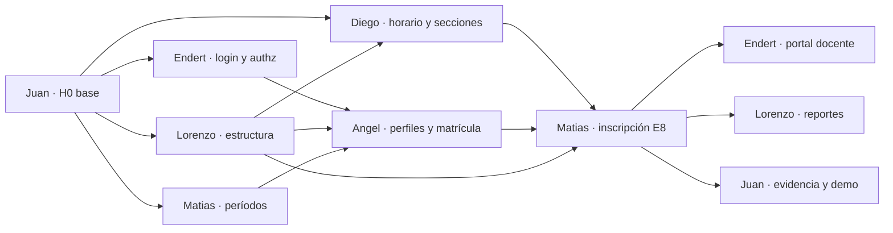

# Asignaciones del equipo — SGA

Este reparto convierte `.cursor/plans/pendientes_sga_y_roles_4366da4a.plan.md` en **6 asignaciones** (una por integrante). Cada una es un archivo con la tarea de esa persona. La IA implementa el código (modelos, servicios, rutas, componentes y tests) siguiendo ese archivo.

| Integrante | Archivo | Rama | Épicos | Revisa / es revisado por |
|---|---|---|---|---|
| **Juan** | [`asignacion-juan.md`](asignacion-juan.md) | `juan-branch` | E0 base · E11 evidencia · base del front | Endert ⇄ Juan |
| **Endert** | [`asignacion-endert.md`](asignacion-endert.md) | `endert-branch` | E1 auth/usuarios/parámetros · E9 portal docente | Juan ⇄ Endert |
| **Lorenzo** | [`asignacion-lorenzo.md`](asignacion-lorenzo.md) | `lorenzo-branch` | E2 estructura · E10 reportes | Angel ⇄ Lorenzo |
| **Angel** | [`asignacion-angel.md`](asignacion-angel.md) | `angel-branch` | E4 personas · E5 matrícula | Lorenzo ⇄ Angel |
| **Matias** | [`asignacion-matias.md`](asignacion-matias.md) | `matias-branch` | E3 períodos · E8 inscripción | Diego ⇄ Matias |
| **Diego** | [`asignacion-diego.md`](asignacion-diego.md) | `diego-branch` | E6 oferta/horarios · E7 consulta de oferta | Matias ⇄ Diego |

Las parejas de revisión no son al azar: cada una revisa el código **del que más depende** (Angel↔Lorenzo: planes y matrículas; Matias↔Diego: secciones e inscripciones; Juan↔Endert: base y auth). Así quien revisa entiende lo que revisa.

## Cómo se usa (para cada integrante)

1. Crea tu *worktree* en tu rama (comandos al final de tu archivo).
2. Abre tu IA (Claude Code, Cursor…) **en la raíz del repo** y dile exactamente:
   > *Lee `asignaciones/asignacion-<tu nombre>.md` completo y síguelo al pie de la letra como mi tutor. Empieza por la Etapa 0.*
3. La IA implementa la tarea de ese archivo, con tests, cuando se lo pides.
4. Tus decisiones quedan en `asignaciones/bitacoras/<tu nombre>.md` (plantilla en [`bitacoras/_PLANTILLA.md`](bitacoras/_PLANTILLA.md)). Esa bitácora se enlaza en cada PR.

## Orden de trabajo e hitos

Mientras Juan entrega la base (**H0**), el resto **no espera sin hacer nada**: avanza en las etapas E0 (comprensión), E1 (diseño y contratos) y E2 (tests) de su tarea, que no necesitan el backend. Recién cuando H0 está en `pre-main` se pasa a E3 (implementación).

| Hito | Contenido | Quién | Sprint del backlog | Fecha límite |
|---|---|---|---|---|
| **H0 · Fundación** | Esqueleto del backend, errores y paginación, infraestructura de tests, runner de seed, `lib/api.ts`, higiene del repo | Juan (JUA-1…4) | S1 | _completar_ |
| **H1 · Modelos y acceso** | `Usuario` + login + `authenticate/authorize` · modelos de sedes/asignaturas/carreras/planes · `Periodo` · esquemas de perfil · `utils/horario.js` + `Seccion` | Endert (END-1,2) · Lorenzo (LOR-1,2) · Matias (MAT-1) · Angel (ANG-1) · Diego (DIE-1,2) | S1–S2 | _completar_ |
| **H2 · CRUD de base** | Usuarios y parámetros · estructura y prerrequisitos · API de períodos · perfiles | Endert (END-3,4) · Lorenzo (LOR-3,4,5) · Matias (MAT-2) · Angel (ANG-2) | S1–S2 | _completar_ |
| **H3 · Oferta y matrícula** | Matrícula · secciones con choque de docente · consulta de oferta · seeds 07–09 coherentes | Angel (ANG-3,4) · Diego (DIE-3,4) | S3–S4 | _completar_ |
| **H4 · Inscripción** | Las 7 reglas, cupo atómico, anulación, pruebas de evidencia | Matias (MAT-3…7) | S4 | _completar_ |
| **H5 · Frontend integrado** | Todas las pantallas contra la API, mocks retirados | Todos (sus tareas «Frontend») | S4–S5 | _completar_ |
| **H6 · Portal docente, reportes y evidencia** | E9, E10, documentación, diagrama de CU, guion de demo | Endert (END-6) · Lorenzo (LOR-7) · Juan (JUA-6) | S5 | _completar_ |
| **H7 · Entrega** | `pre-main → main` con todo en verde y demo ensayada | Juan | — | _completar_ |

**Regla de oro de las dependencias:** cada dueño entrega primero un **PR pequeño con su modelo + seed + test**, y avisa al grupo. Los demás programan contra ese contrato, o contra un doble de prueba mientras no esté.

## Dueños de archivos compartidos (para evitar conflictos de merge)

| Archivo / zona | Dueño | Cómo pedir un cambio |
|---|---|---|
| `backend/src/{app.js,server.js,config,errors/index,constants/enums.js,utils,middlewares/{errorHandler,validate}}`, `routes/index.js` | Juan | PR chico o mensaje (plantilla R10) |
| `backend/src/middlewares/auth.js`, `config/permisos.js` | Endert | idem |
| `backend/src/models/perfiles.schemas.js` | Angel | idem |
| `backend/src/utils/horario.js` | Diego | idem |
| `db/seed/NN-*.js` | quien figura en el contrato transversal | idem |
| `frontend/src/lib/*`, `app/router.tsx`, `app/navigation.ts` | Juan | cambia **solo tu línea** y avisa en el PR |
| `context/decisions/log.md` | Todos (solo se agrega, más reciente arriba) | — |

## Cobertura del plan (nada quedó sin dueño)

| Ítem del plan | Dueño |
|---|---|
| E0 base, `.env`, errores, healthcheck, seed | Juan |
| E1 auth, usuarios, parámetros, clave | Endert |
| E2 estructura + ciclos | Lorenzo |
| E3 períodos | Matias |
| E4 docentes/estudiantes | Angel (perfil) + Endert (cuenta) |
| E5 matrícula | Angel |
| E6 oferta y choque de docente | Diego |
| E7 consulta de oferta | Diego |
| E8 inscripción + cupo atómico + anulación | Matias |
| E9 portal docente | Endert |
| E10 reportes | Lorenzo |
| E11 tests de reglas contra la API | Matias (pruebas) + Juan (integración, docs, CU, demo) |
| Front 1 · cliente HTTP | Juan |
| Front 2 · `AuthContext` real | Endert |
| Front 3 · reemplazar contextos/mocks | cada dueño del dominio |
| Front 4 · `rules.ts` como validación previa y mensajes del backend | cada dueño del dominio |
| Front 5 · fusionar ABM usuarios/personas | Endert + Angel |
| Front 6 · permisos solo lectura | Endert |
| Front 7 · estados de carga, paginación de servidor, cambio de clave | Juan (hook) + cada dueño + Endert (clave) |
| Front 8 · decisiones de dominio pendientes | ver tabla siguiente |
| Front 9 · texto con codificación rota | Endert |
| Front 10 · `.DS_Store`, `.gitignore` | Juan |

## Decisiones de dominio pendientes (las propone quien figura, las decide el grupo)

| Pendiente | La propone | Se registra en |
|---|---|---|
| Catálogo de jornadas (hoy `diurna`/`vespertina`) | Diego | `context/decisions/log.md` |
| Semipresencial: modalidad por sección o por bloque | Diego | idem |
| Electivas: bolsa libre o lista fija del plan | Lorenzo | idem |
| Tope de créditos por período (¿8.ª regla?) | Matias | idem |
| Historial: solo seed (decisión por defecto del plan) | Angel | idem |
| Admin con lectura de estructura | Lorenzo + Endert | idem |
| Recuperación de clave: por correo o reseteo por admin | Endert | idem (el reseteo por admin es lo asumido) |
| Qué hace una matrícula `suspendida` con sus inscripciones | Angel + Matias | idem |
| Lista de espera | fuera de alcance salvo decisión | idem |

## Diferencias entre este reparto y el plan original (léelas)

- **Bloques horarios:** el plan decía `{dia, horaInicio, horaFin}`; el contrato usa `{dia: 0..5, inicioMin, finMin}` porque el frontend ya trabaja en minutos y los solapes son más simples y seguros así.
- **Enums:** viajan en ASCII (`inscripcion_abierta`, `historico`) y el front los traduce; hoy el mock usa tildes y espacios.
- **`context/decisions/log.md`** no registra aún la decisión de MVP simplificado (10 colecciones, sin `salas`). Juan la agrega en JUA-4.
- **`backlog-sga.md`** (las 85 tarjetas) no está en el repo; se usa `context/specs/backlog.md` como mapa. Las `D-xx` y los criterios de cada tarea hacen de tarjeta.

## Cómo comprobar que aprendieron (para Juan)

1. **Bitácoras:** `asignaciones/bitacoras/*.md` debe tener una entrada por cada `D-xx`, con las palabras de la persona. Muchas decisiones marcadas «asistida» o respuestas calcadas del texto de la tarea son una señal de alerta.
2. **PR:** debe enlazar la bitácora, traer tests escritos *antes* del código (mira el orden de commits) y cumplir el checklist.
3. **Defensa:** además de la que hace la IA, pídele a cada persona que explique una decisión clave en la reunión del hito.
4. **Señales de «camino fácil»:** un solo commit gigante · tests que aparecen junto con el código · mensajes de commit genéricos · código que su autor no sabe explicar · decisiones sin alternativa descartada.
